

  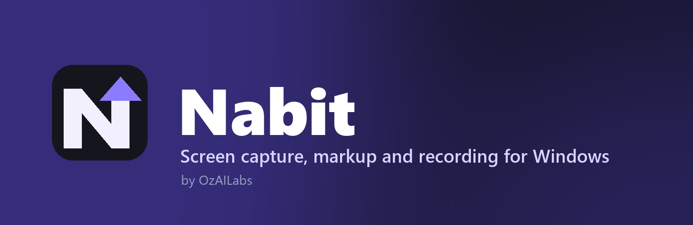

  <b>Capture anything on your screen, explain it in seconds, and send it where it needs to go.</b> 
  Scrolling capture · Arrows, callouts and steps · Blur · Grab Text · Screen recording · One-click sharing

  <a href="../../releases/latest"><b>Download for Windows</b></a> ·
  <a href="#features">Features</a> ·
  <a href="#install">Install</a> ·
  <a href="#for-it-teams">For IT teams</a>

---

  <a href="https://ozailabs.github.io/nabit/tour.html">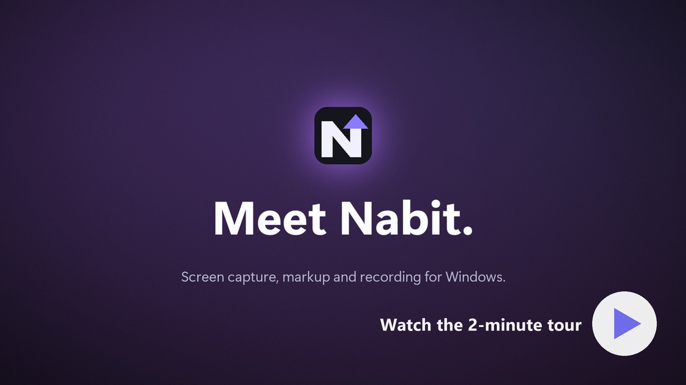</a>

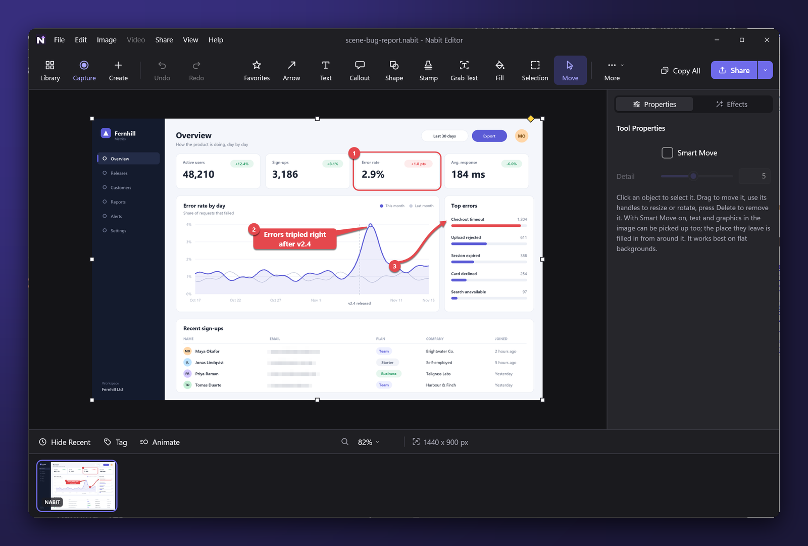

## Features

### Capture the whole page, not just what fits on the screen
Point Nabit at a window or an area and it scrolls the content for you, joining it into one tall image.
Long web pages, chats, documents and lists all come out in one piece.

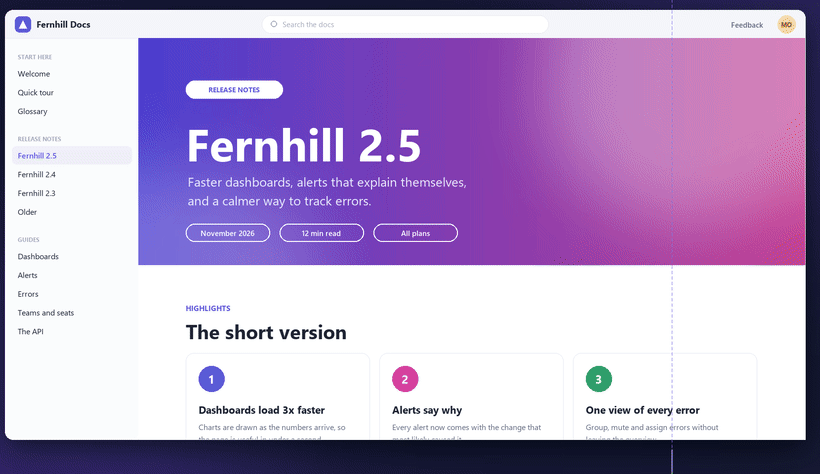

### Explain it in seconds
Arrows that curve, callouts you type straight into, numbered steps that count themselves, shapes,
highlights, stamps, text and freehand pen. Everything stays editable until you share it.

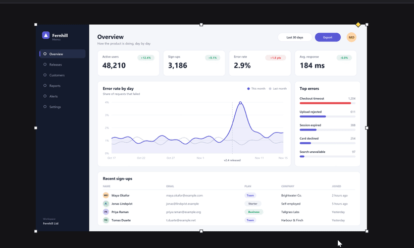

### Hide what's private
Blur or pixelate names, emails and numbers before anyone else sees them.

### Grab the text
Copy the text out of any capture. It is read on your PC, and nothing is uploaded.

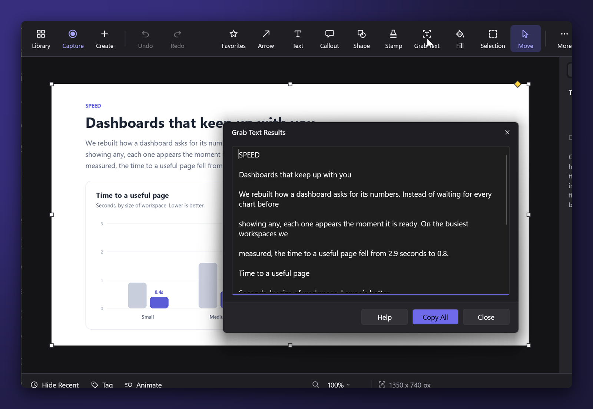

### Record the screen, and draw on it as you go
Record any part of the screen with the system sound and your microphone, and draw arrows and boxes
on the screen while you record. Trim, cut and join recordings in the Editor, save frames, or make a GIF.

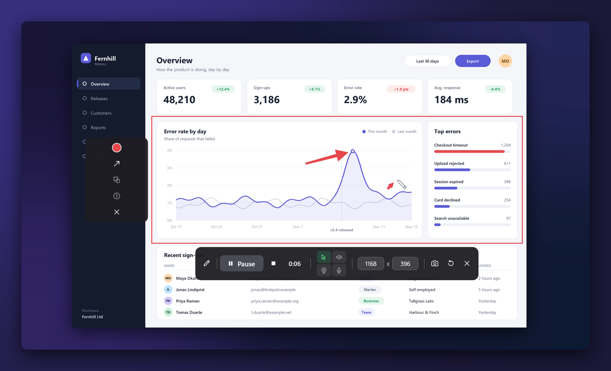

### Make your markup move
Arrows draw themselves, callouts type themselves and steps pop in one after another. Save it as a GIF.

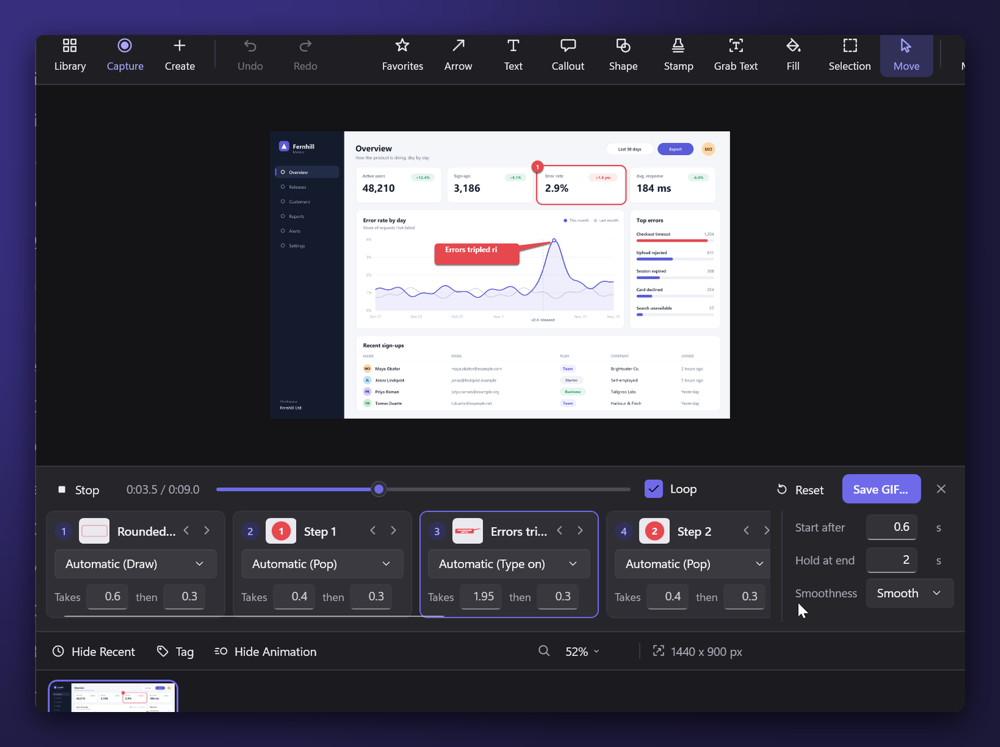

### Send it anywhere
Copy it and paste it into a chat or a document, drag it out of Nabit into any program, or send it to a
file, an email or an FTP server.

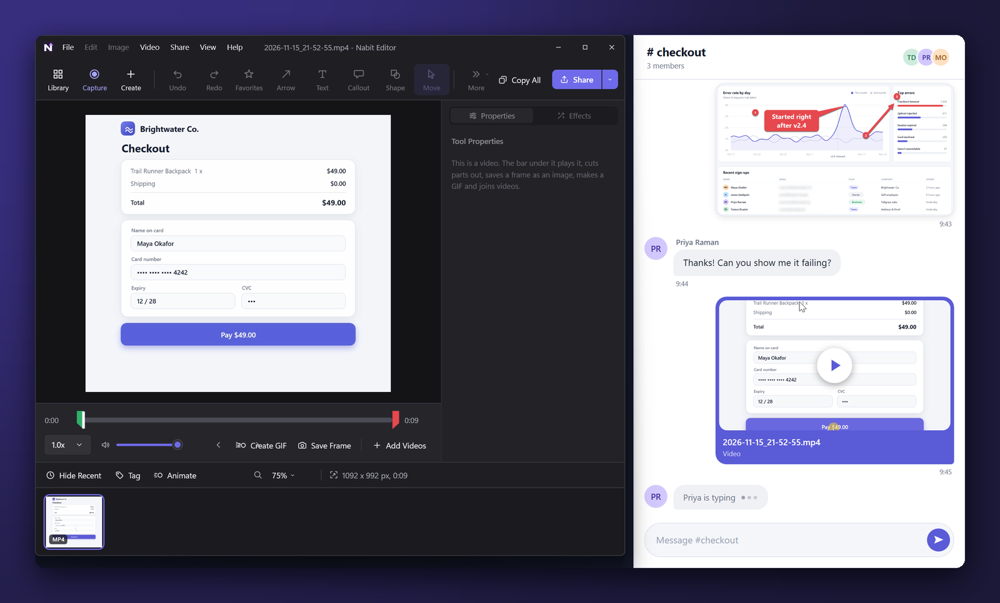

### Light or dark, your way
Nabit follows the Windows theme, or keeps the one you choose. The toolbar, keys, styles and themes
can all be set up the way you work.

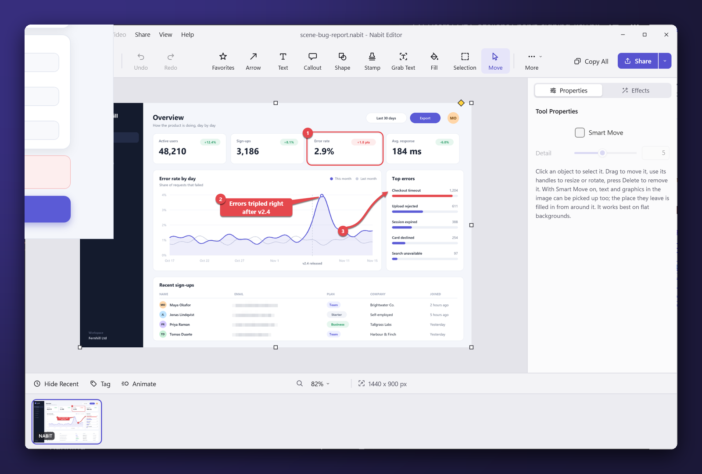

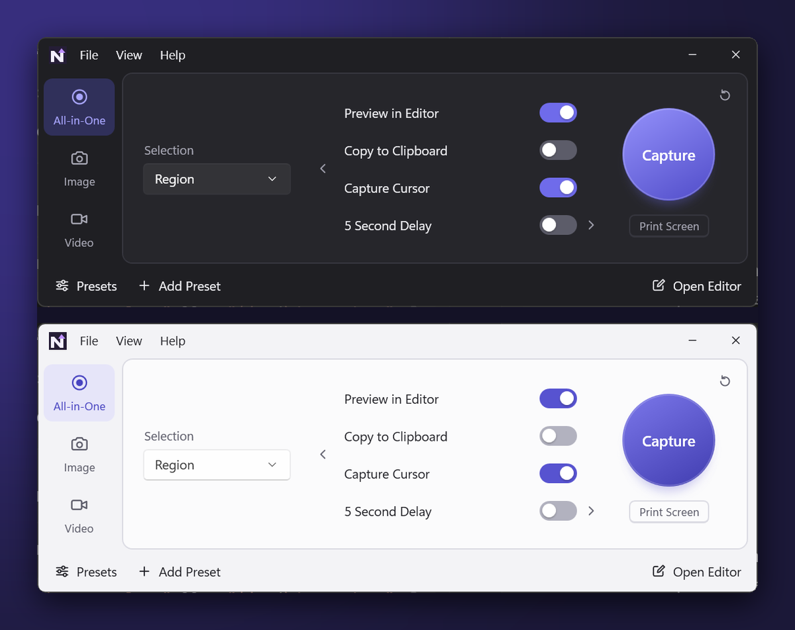

## Private by design

Nabit works on your PC. Your captures and recordings are kept in your own Library folder and are
never sent anywhere unless you share them yourself. Text recognition runs on your PC too.

## Install

1. Download the latest `Nabit-<version>-x64.msi` from [Releases](../../releases/latest).
2. Run it. Nabit and the Nabit Editor appear in the Start menu.

The installer is not yet code-signed, so Windows SmartScreen may say it comes from an unknown
publisher. Choose **More info**, then **Run anyway**.

Nabit needs Windows 10 version 2004 or later, or Windows 11, 64-bit. Everything else it needs is
included in the installer.

## For IT teams

The installer is a standard per-machine MSI, built for Intune, Configuration Manager and Group Policy.

| What | Command |
|---|---|
| Silent install | `msiexec /i Nabit-<version>-x64.msi /qn` |
| Silent install with a licence key for every user of the PC | `msiexec /i Nabit-<version>-x64.msi /qn LICENCEKEY="NABIT1...."` |
| Silent uninstall | `msiexec /x {ProductCode} /qn` |

A licence key can also be set for a whole organisation with the registry value `LicenceKey` (string)
under `HKLM\SOFTWARE\Policies\OzAILabs\Nabit`, for example from an Intune script or Group Policy
Preferences. Users can enter their own key in Help > Licence.

Uninstalling removes the programs and leaves each user's captures and settings.

## Licence

Nabit is proprietary software by OzAILabs. Its source code is not public. Third-party notices are
in the app under Help > Third-Party Notices.

© 2026 OzAILabs. All rights reserved.
